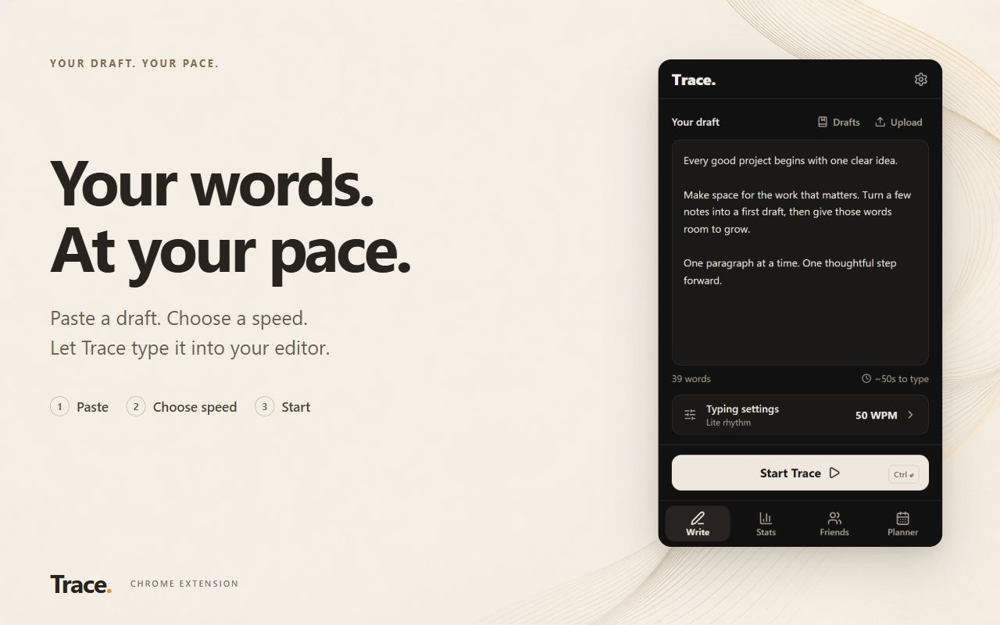
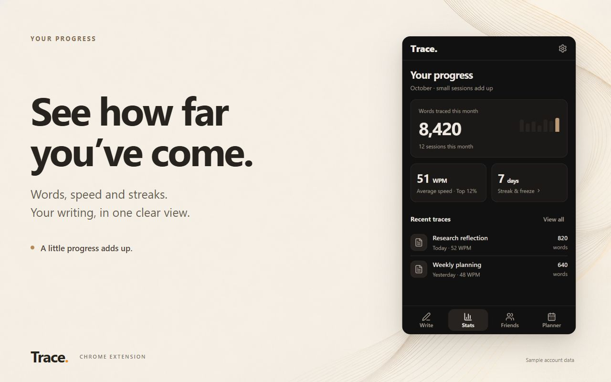

<picture>
  <source media="(prefers-color-scheme: dark)" srcset="assets/banner-dark.svg">
  
</picture>

I'm an Information Technology (B.Hons) student at Ontario Tech University and a Data & Product Research Analyst Intern at The Canada List. I build full-stack products and work with data.

**Open to software development and data/product analyst co-op and internship roles.**

[Portfolio](https://asadgohar-portfolio.vercel.app) · [LinkedIn](https://www.linkedin.com/in/asad-gohar) · [Trace](https://tracetype.me)

## Featured project: Trace

[Trace](https://github.com/AsadGoharr/Trace) is a Chrome extension with a web dashboard. It types text you have already written into web editors one keystroke at a time, at a speed you choose, for editors that block or mangle paste. It is on the [Chrome Web Store](https://chromewebstore.google.com/detail/fcmocfafblllhjbpcbliedmpoklfgape) with a free plan and a paid Pro plan.

  
  

I design, build, test and release all of it:

- A Manifest V3 extension and a React single-page dashboard, both in TypeScript with Vite, and a Tailwind CSS v4 interface
- Supabase for auth, Postgres, realtime and scheduled edge functions (Deno), and Stripe for subscriptions
- Opt-in analytics: the SDK loads only after the user agrees, and draft text, titles and URLs are never sent
- GitHub Actions CI on every push (extension, website, edge functions and release checks) with 1,800+ automated tests
- Versioned releases to the Chrome Web Store and a public [changelog](https://tracetype.me/changelog)

The application source is private. The Trace repository holds the documentation.

## Other work

- [Portfolio](https://github.com/AsadGoharr/portfolio): my personal site, built with React, Vite, Tailwind CSS, Framer Motion and Three.js, deployed on Vercel ([live](https://asadgohar-portfolio.vercel.app))

## Skills

| Area | What I use |
|---|---|
| Languages | TypeScript, JavaScript, SQL, HTML, CSS |
| Front end | React, Vite, Tailwind CSS, Framer Motion, Three.js |
| Back end and data | Node.js, Supabase (PostgreSQL, Auth, Edge Functions), Stripe |
| Tools | Git, GitHub Actions, Vercel, Chrome extension APIs |

## Experience and education

- Data & Product Research Analyst Intern, The Canada List (2025 to present)
- B.Hons Information Technology, Ontario Tech University (2024 to present)
- Certifications: AWS Cloud Practitioner, Google Data Analytics, Azure Fundamentals
- Recognition: TELUS Student Bursary (1 of 29 recipients), Ontario Scholar, Interac U-Innovate Challenge participant

## Get in touch

The best way to reach me is [LinkedIn](https://www.linkedin.com/in/asad-gohar).
