<picture>
  <source media="(prefers-color-scheme: dark)" srcset="assets/banner-dark.svg">
  
</picture>

[Portfolio](https://asadgohar-portfolio.vercel.app) · [LinkedIn](https://www.linkedin.com/in/asad-gohar)

## What I'm up to

- Studying Information Technology (B.Hons) at Ontario Tech University
- Interning as a Data & Product Research Analyst at The Canada List, on market research, dashboards and competitive analysis
- Building web apps and a Chrome extension in my own time
- Looking for software development and data/product analyst co-op and internship roles

## Things I've built

| Project | What it is | Built with |
|---|---|---|
| [Trace](https://github.com/AsadGoharr/Trace) | A Chrome extension and web dashboard that types text you have already written into web editors at a speed you choose. On the [Chrome Web Store](https://chromewebstore.google.com/detail/fcmocfafblllhjbpcbliedmpoklfgape), source private. | TypeScript, React, Supabase, Stripe |
| [Portfolio](https://github.com/AsadGoharr/portfolio) | My personal site, with a 3D hero and animated sections. [Live](https://asadgohar-portfolio.vercel.app). | React, Vite, Three.js, Framer Motion |

## Tools I use

| Area | Tools |
|---|---|
| Languages | TypeScript, JavaScript, SQL, HTML, CSS |
| Front end | React, Vite, Tailwind CSS, Framer Motion, Three.js |
| Back end and data | Node.js, Supabase (PostgreSQL, Auth, Edge Functions), Stripe |
| Workflow | Git, GitHub Actions, Vercel, Chrome extension APIs |

## Background

- Data & Product Research Analyst Intern, The Canada List (2025 to present)
- B.Hons Information Technology, Ontario Tech University (2024 to present)
- Certifications: AWS Cloud Practitioner, Google Data Analytics, Azure Fundamentals
- Recognition: TELUS Student Bursary (1 of 29 recipients), Ontario Scholar, Interac U-Innovate Challenge participant
